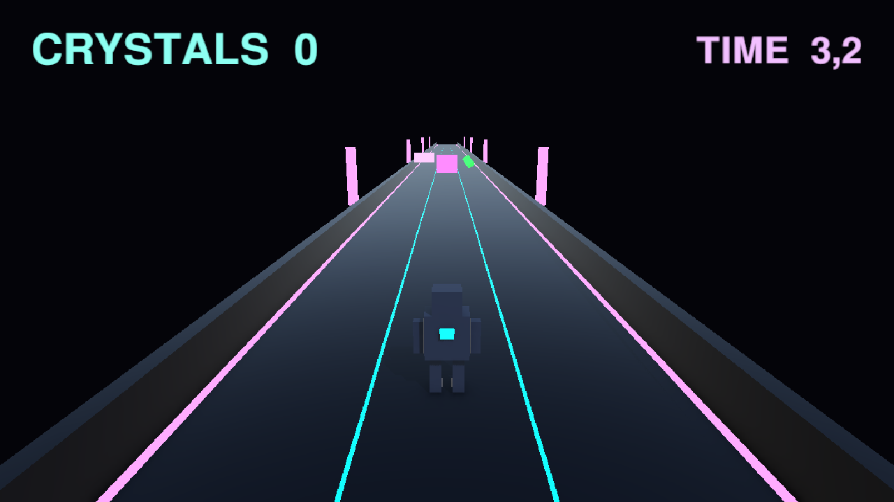
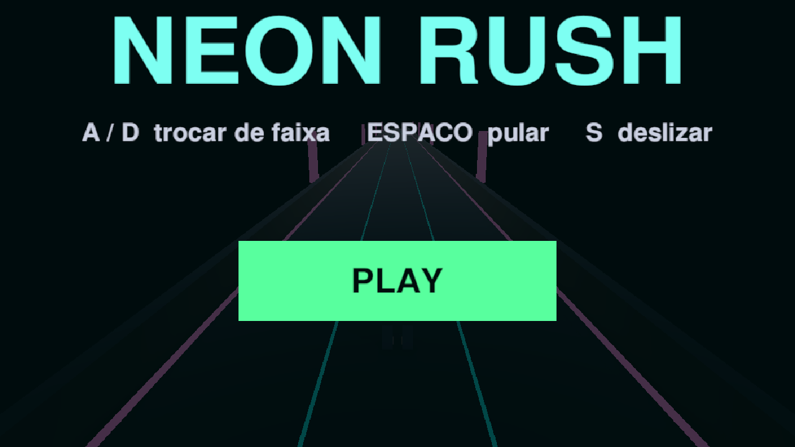
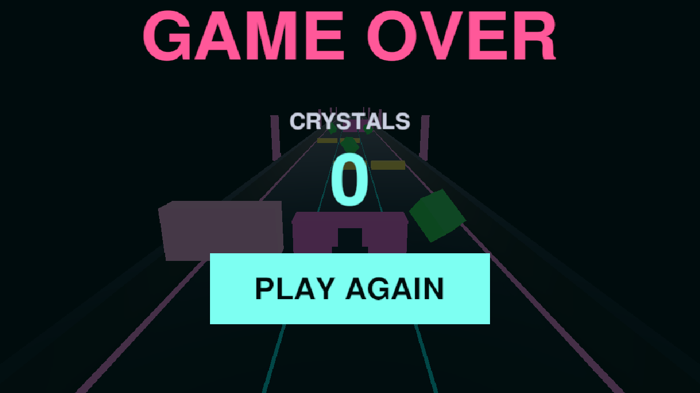

# Neon Rush 3D — prova de conceito



Corrida infinita 3D jogável, montada com primitivas da Unity como prova de conceito de
desenvolvimento assistido por **GitHub Copilot + Unity MCP** no VS Code.

| Item | Valor |
|---|---|
| Unity | 6000.6.7f1 |
| Render pipeline | URP 17.6.0 |
| Input | Input System 1.20.1 (novo, sem `UnityEngine.Input`) |
| Cena principal | `Assets/Scenes/Game.unity` |
| Dependências externas | nenhuma |

## O jogo

O robô corre sobre uma pista de três faixas enquanto o cenário avança. O jogador troca de faixa,
salta e desliza para desviar de obstáculos e coletar cristais. Cada cristal vale **10 pontos**; o
primeiro impacto encerra a partida. A dificuldade cresce com o tempo de sobrevivência, e o ciclo
menu → partida → fim de jogo → reinício acontece sem recarregar a cena.

## Capturas de tela

| Menu inicial | Partida | Fim de jogo |
|---|---|---|
|  |  |  |

As três imagens foram capturadas em **Play Mode**, a 1280×720, pelo comando `capture game_view`
do pacote Unity Pipeline — não são montagens nem mockups.

## Como executar

1. Abra o projeto no Unity **6000.6.7f1** (versão registrada em `ProjectSettings/ProjectVersion.txt`).
2. Abra a cena `Assets/Scenes/Game.unity` — ela é a primeira da lista de Build Settings.
3. Pressione **Play**.
4. Clique em **PLAY** no menu inicial.

## Controles

| Ação | Teclas |
|---|---|
| Trocar de faixa | `A` / `←` e `D` / `→` |
| Pular | `Espaço` / `↑` |
| Deslizar | `S` / `↓` |

Fora da partida a entrada do jogador fica desabilitada, então o teclado não interfere nos menus.

## Regras

- A pista tem três faixas, com o jogador preso ao centro em X e limitado entre as faixas externas.
- As ondas ocupam uma ou duas faixas, nunca as três: sempre existe uma faixa livre.

Cada tipo de obstáculo exige uma ação diferente para ser evitado:

| Prefab | Posição | Como passar |
|---|---|---|
| `ObstacleBlocker` | faixa inteira | trocar de faixa |
| `ObstacleLow` | rente ao chão | pular |
| `ObstacleHigh` | suspenso | deslizar |

- Cristais só aparecem em vagas livres de obstáculos e contam uma única vez por coleta.
- O HUD mostra os cristais coletados (`CRYSTALS`) e o tempo de sobrevivência (`TIME`).
- O reinício limpa pontuação, faixa, dificuldade e devolve ao pool tudo que estava em jogo.

## Dificuldade progressiva

O `DifficultyManager` é a fonte única dos valores; os dois geradores leem dele em vez de guardarem
cópias. A rampa é linear e satura nos limites, para a partida continuar possível.

| Parâmetro | Início | Limite | Janela |
|---|---|---|---|
| Velocidade do cenário | 12 u/s | 26 u/s | 75 s |
| Intervalo entre ondas de obstáculos | 1,60 s | 0,85 s | 75 s |
| Intervalo entre grupos de cristais | 1,90 s | 1,15 s | 75 s |

## Estrutura do projeto

```text
Assets/
  Scenes/Game.unity      cena única do jogo
  Scripts/               componentes de gameplay
  Prefabs/               3 obstáculos + cristal
  Materials/             materiais URP
  Settings/              perfis do URP
docs/screenshots/        capturas usadas neste README
prompts/                 prompts do roteiro original, um por etapa
tasks/tasks.md           quadro de progresso e critérios de aceite
```

## Componentes principais

| Script | Responsabilidade |
|---|---|
| `GameFlow` | Alterna menu, HUD e fim de jogo; liga/desliga entrada e geradores; reinicia sem recarregar a cena |
| `GameState` | Estado global mínimo da partida e evento `GameOver` disparado uma única vez |
| `PlayerInput` / `PlayerInputPoller` | Leitura do Input System amostrada uma vez por frame |
| `LaneMover` | Movimento lateral suavizado entre as três faixas |
| `JumpAndSlide` | Salto, deslize e redimensionamento do collider durante o deslize |
| `PlayerMotor` | Um único `CharacterController.Move` por frame; eixo Z travado |
| `Obstacle` / `ObstacleSpawner` | Prefabs, ondas por faixa, pooling e detecção de colisão |
| `Crystal` / `CrystalSpawner` | Coleta por trigger, rotação/flutuação, pooling e vaga livre |
| `ScoreManager` | Pontuação da partida e notificação de mudança |
| `ScoreHud` / `SurvivalTimeHud` | Espelham pontuação e tempo congelado no fim da partida |
| `DifficultyManager` | Velocidade, intervalos e tempo de sobrevivência em um só lugar |
| `GameFeedback` / `CameraShake` | Flash de coleta e de impacto, tremor de câmera e ganchos de áudio |

## Estado da implementação

O quadro detalhado, com os testes já executados, está em [tasks/tasks.md](tasks/tasks.md).

| Etapa | Estado |
|---|---|
| T0 — Diagnóstico do projeto e das ferramentas MCP | concluída |
| T1 — Cenário 3D, personagem provisório e câmera | concluída |
| T2 — Movimentação do jogador | implementada e verificada por automação; falta o teste com teclado físico |
| T3 — Obstáculos, geração e colisão | implementada e verificada por automação; falta o teste com teclado físico |
| T4 — Cristais e pontuação | implementada e verificada por automação; falta a avaliação visual humana |
| T5 — Progressão da dificuldade | implementada e verificada por automação; falta avaliar o conforto da rampa |
| T6 — Interface, áudio e polimento | implementada e verificada por automação; falta o teste de clique real nos botões |
| T7 — Validação final | pendente |

## Áudio e limitações conhecidas

- **Não há arquivos de áudio no projeto.** O `GameFeedback` já expõe os campos de música, coleta,
  impacto, salto e deslize; o jogo roda em silêncio até os clipes serem arrastados no Inspector.
- O visual usa primitivas 3D e materiais simples — é uma prova de conceito, não arte final.
- `Assets/Scenes/SampleScene.unity` é a cena de exemplo do template e não faz parte do jogo.
- Não existem testes automatizados (EditMode/PlayMode) no projeto. As validações registradas em
  `tasks/tasks.md` foram feitas em Play Mode pelo próprio agente, via MCP.
- O teste com teclado físico e o clique real nos botões dependem de intervenção humana.

## Como esta POC foi construída

O repositório mantém o roteiro original em sete etapas:

- [prompts/](prompts) — um prompt por etapa (diagnóstico, cenário, movimentação, obstáculos, cristais,
  progressão, interface/áudio e validação final).
- [tasks/tasks.md](tasks/tasks.md) — fonte de verdade do progresso, com os critérios de aceite e as limitações
  encontradas em cada etapa.
- [.github/copilot-instructions.md](.github/copilot-instructions.md) — regras de trabalho do agente no projeto.

Cada etapa foi implementada em código, compilada no Editor e verificada em Play Mode pelas
ferramentas conectadas ao Editor — MCP nas etapas e Pipeline na captura final: inspeção de
hierarquia, `script eval`, espera por frames, captura de tela e leitura do console. O que não pôde
ser provado por ferramenta está marcado como pendente de teste manual, em vez de dado como
concluído.

## Convenção de commits

```bash
git add .
git commit -m "Neon Rush: diagnostico inicial"
git commit -m "Neon Rush: cenario 3D"
git commit -m "Neon Rush: movimentacao do jogador"
```
